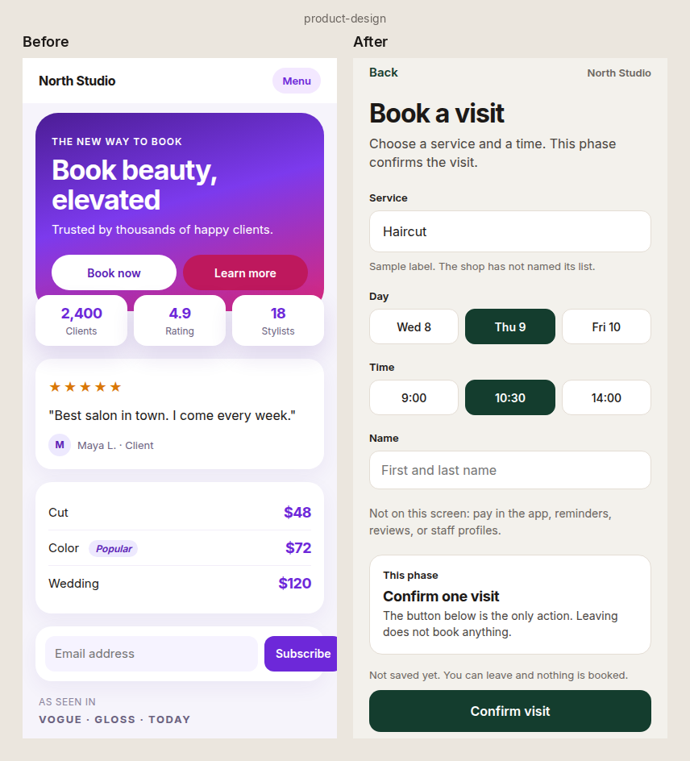
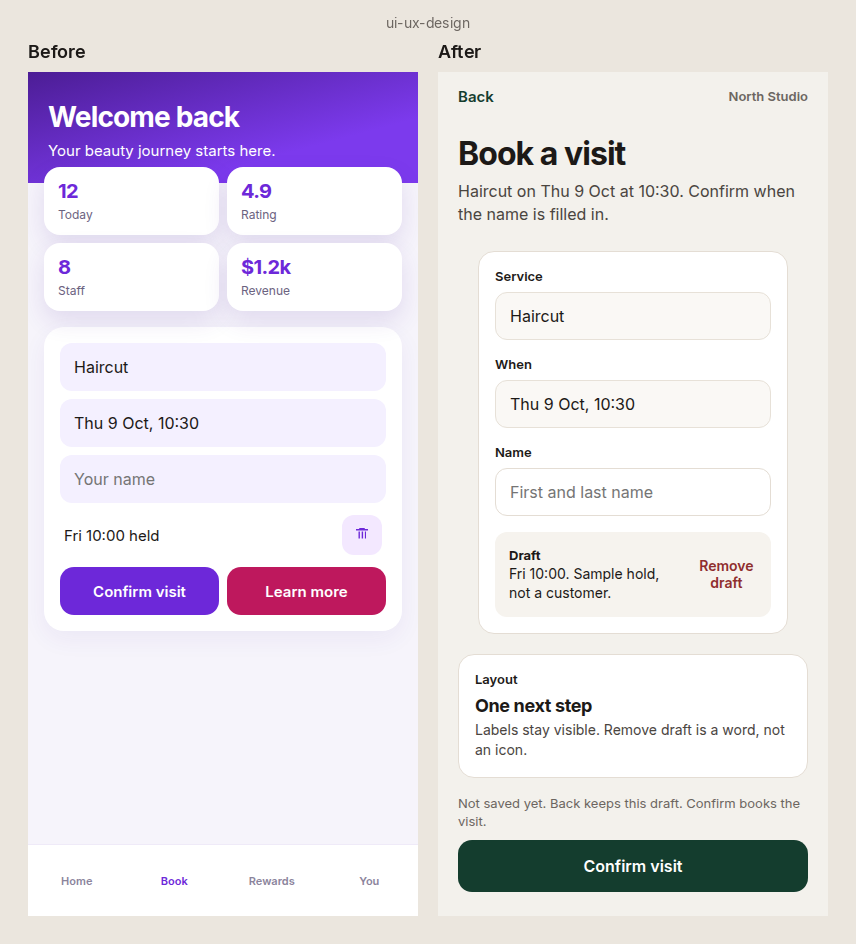
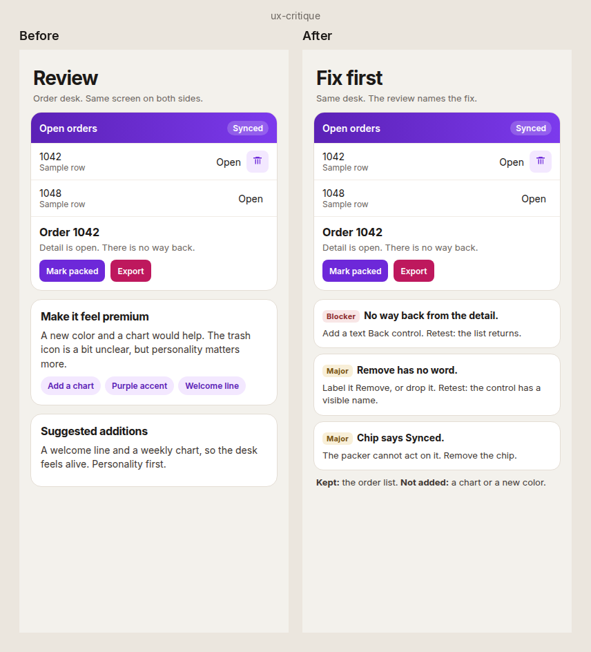
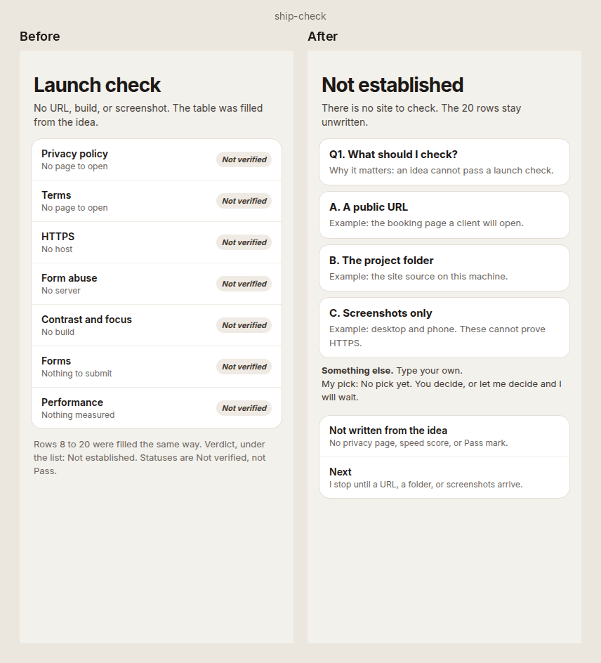
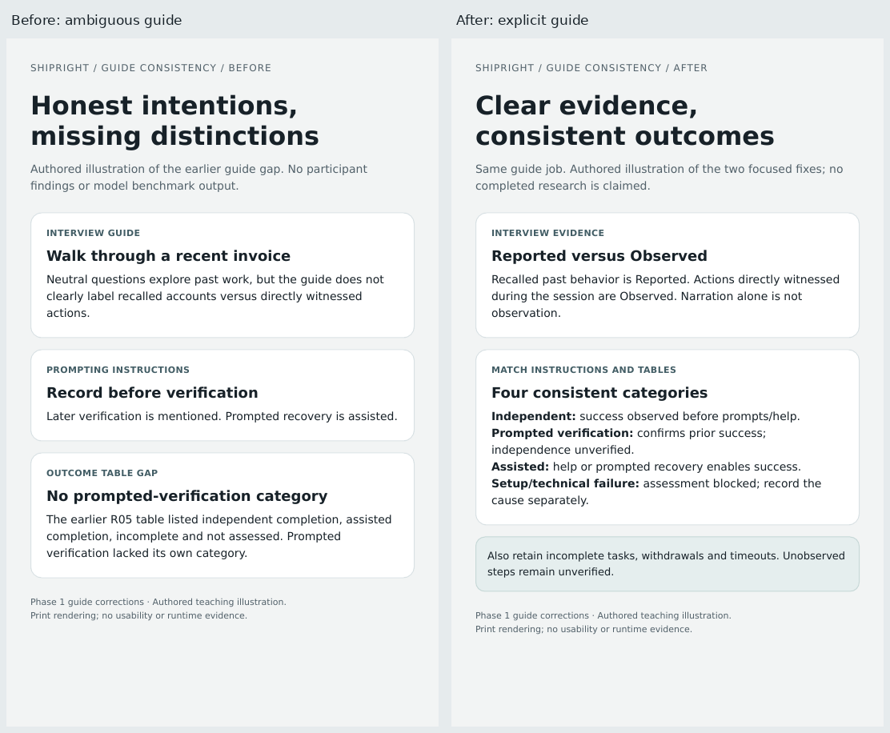
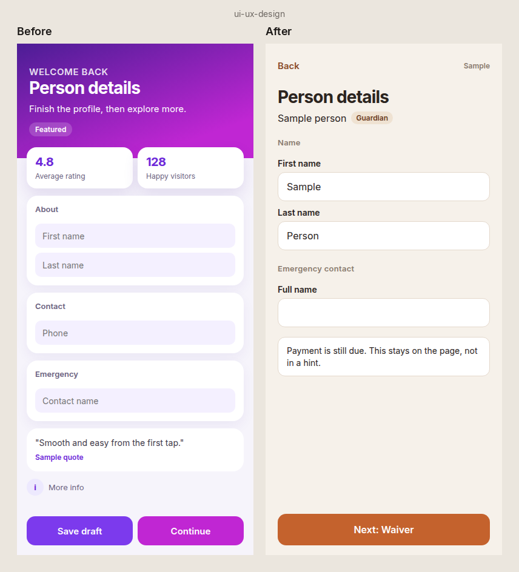

# Changelog

## 1.3.0 - 2026-10-18

Not tagged. Not merged. Not released. There is no 1.3 zip. Use the repository.

- Stages 0 to 10, a project record, and a case study that may only use numbers already in the record.
- Pitch deck template. Market, model, and ask stay blank unless the owner supplied them. `check-record.mjs` rejects an unsourced number.
- Seventeen plain blocks, plus scroll-story, product-3d, and page-transition for a premium site.
- The site in `site/` rebuilt on that draft: self-hosted Inter and Fraunces, a pinned run, a before/after slider, a proof section that says "results coming", and a c7 case study from baseline evidence only.
- Eval prompts for 8 cases times Sonnet, Haiku, and Opus, plus 2 hidden cases. Not launched. No scores.
- Limits: baseline 1.2 is not graded. 1.3 runs do not exist yet. Taste on the new site is Not verified.

- Merged in PR 21 and released as v1.3.0. Backup tag: backup-2026-10-18-pre-1.3. No zip asset; install from the repo.

## 1.2.0 - 2026-10-14

- Added guided website research, real product heroes and six-act story architecture.
- Added three distinct story options, ten individually loaded technique recipes and longer website prompts. App paths and ticket caps remain.
- Added the premium UI profile, first-screen product Blocker, reduced-motion checks and new regression tests.
- Credited all 16 requested pattern sources without copying site code or assets.
- Preserved a fresh cards-only intake response despite "just build it".
- Built two proofs only after the text: [ShipRight before/after](examples/before-after/1.2/shipright/compare.png) and [sample recorder comparison](examples/before-after/1.2/field-recorder/compare.png), against the [actual PR 18 Depth baseline](examples/before-after/1.2/depth/desktop.png).
- Saved [ShipRight after screenshot](examples/before-after/1.2/shipright/evidence/check-ui/desktop.png), [recorder after screenshot](examples/before-after/1.2/field-recorder/evidence/check-ui-polish/desktop.png), [ShipRight scroll video](examples/before-after/1.2/shipright/evidence/desktop-scroll.webm) and [recorder scroll video](examples/before-after/1.2/field-recorder/evidence/scroll.webm).
- Independent review found and retested product overlap, font glyph, reading-size and per-view label defects. [Final verdict](examples/before-after/1.2/review/final-review.md): ready for local proof review. Original captures and first findings remain.
- 55 regression tests passed. Source and pinned token checks passed. Both builds and premium checks pass with disclosed compact-text warnings. CI now installs Chromium/Playwright and smoke-checks browser availability before regression discovery.
- Updated version metadata and distribution artifacts to 1.2.0.
- Limits: one fresh builder per proof, software WebGL, unverified physical-device performance/full assistive technology, absent external reference image pack, unverified browser reference trust and a Brand Studio CAPTCHA challenge.
- Merged in PR 19 and released as v1.2.0. Backup tag: backup-2026-10-14-pre-1.2.

## 1.1.0 - 2026-10-14

One skill, one install. ShipRight is now `shipright`, the same shape as a Remotion or HyperFrames skill.

### Added

- **One router** at `skills/shipright/SKILL.md`. It picks one mode: build-pack (the default for a new idea), product-design, ui-ux-design, ux-critique, or ship-check. The old skill files moved to `skills/shipright/modes/<mode>/MODE.md` and still load their references one step at a time.
- **Full flow for a new project.** The router and build-pack mode require this order: build pack, a design preview with 2-3 directions then a stop, build, ux-critique plus `scripts/check-ui.mjs` until clean, then ship-check. "Just build it", "skip the plan", and a one-go agent prompt do not skip a step. A skip is allowed only when the user names that step and accepts the stated risk. A run with no human still picks a direction, marks it "Proposed, awaiting owner approval", and still critiques and ship-checks.
- **Claude Code plugin and marketplace** in `.claude-plugin/`. Install with `/plugin marketplace add aiwithaltaz/shipright-skills`, then `/plugin install shipright@shipright`. Type `/shipright`.
- **`npx skills add aiwithaltaz/shipright-skills`** for Cursor, Codex, VS Code Copilot, Antigravity, and Gemini CLI. The same command works for Claude Code.
- **`scripts/release_skill.py`** writes `dist/shipright.zip` for a Claude.ai skill upload and `dist/shipright-chatgpt.md` for ChatGPT project instructions or a Custom GPT.

### Changed

- The five mode names, safety rules, gates, and token budgets stay. Checkers follow the new paths. Historical eval outputs are unchanged.
- **Claude Code command.** Removed `commands/shipright.md`. That file registered `/shipright:shipright`. The skill command to type is `/shipright`. A marketplace install also lists the plugin skill as `/shipright:shipright`; both names run the same skill.
- **Old operator-workspaces links.** `skills/ui-ux-design/references/operator-workspaces.md` is a short redirect to the moved file. The two IVC example pages are unchanged, so their evidence hashes stay the same.

## 1.0.0 - 2026-10-13

Idea in, build pack out. ShipRight now works like a small agency team and hands your coding tool small, exact prompts. See [release notes](RELEASE-NOTES.md).

### Added

- **build-pack skill**, the new front door: PRD, stack with reasons, design system with tokens, screen specs and paste-ready ticket prompts in one pass. Ten pack checks before the reply.
- **Starter systems** with real, contrast-checked numbers: calm dense, mobile native, editorial marketing, immersive dark. Your own system or Figma always wins; a new app shows its system for a quick OK first.
- **Mobile and marketing guidance**: platform conventions, form flows, argument-first marketing pages with real proof only.
- **Motion and 3D guidance**: a should-it-move gate, GSAP and Lenis rules for marketing, React Three Fiber budgets, fallback images, keyboard and screen-reader access.
- **scripts/check-ui.mjs**: measures a rendered page in Chromium at 1280 and 390 wide. Used in a look-and-fix loop before handoff and in critique.
- **Stack choices** by product type and coding tool, with switch points.
- **Worked examples** per product type on subjects unlike the trial cases.
- **SOURCES.md** with every source and license. Skills cite it and never load it.
- **evals/v1**: frozen prompts, rubric, run and grader protocol, offline vendor libraries, baseline and new runs, blind grades.

### Changed

- 30 references merged into 9. Every protected safety sentence kept its wording. Guidance fell from 37,070 to about 30,000 tokens while adding the new skill and topics.
- Tickets are prompts with files to read, done-when checks and a stop line. Reversible choices use a Proposed default instead of blocking.
- Dense-but-calm layout rules, measured slop tells, preview pages that open in the default state.
- Core Web Vitals targets and 3D budgets in ship-check.

### Removed

- The Phase 1 to 5 tests that pinned exact reference wording. Safety rules keep tests in tests/test_v1_safeguards.py. Historical evidence is hash-checked and unchanged.

### Evidence

Final blind trial: 112/120 for v1.0 against 93/120 for 0.6.2 with the fixed 3D re-check (105/120 as first run, when the 3D page hid content behind a scroll animation and was unshippable). Phase 3 trial: 107 against 94. Details and limits: [evals/v1/results-final.md](evals/v1/results-final.md).

### Before and after

Actual generated outputs from the same frozen prompts: 0.6.2 on the left, 1.0 on the right.

- SaaS dashboard: [desktop](examples/before-after/v1.0/saas-dashboard/compare-desktop.png), [phone](examples/before-after/v1.0/saas-dashboard/compare-phone.png).
- Mobile form flow: [phone](examples/before-after/v1.0/mobile-form/compare-phone.png), [desktop](examples/before-after/v1.0/mobile-form/compare-desktop.png).
- Marketing site, final trial run: [desktop](examples/before-after/v1.0/marketing-site/compare-desktop.png), [phone](examples/before-after/v1.0/marketing-site/compare-phone.png). This run hid some content until scroll.
- Marketing site, re-run after the motion fix: [desktop](examples/before-after/v1.0/marketing-site-fixed/compare-desktop.png), [phone](examples/before-after/v1.0/marketing-site-fixed/compare-phone.png). Hidden content now passes; this run scrolls 158px sideways on a phone, see results-final.md.
- Marketing site, re-run with the grid rule: [desktop](examples/before-after/v1.0/marketing-site-grid/compare-desktop.png), [phone](examples/before-after/v1.0/marketing-site-grid/compare-phone.png). Hidden content and phone overflow both pass at 1280 and 390 (0 FAIL, 1 WARN). Checked, not graded.
- 3D product site, re-run after the motion fix: [desktop](examples/before-after/v1.0/3d-product-fixed/compare-desktop.png), [phone](examples/before-after/v1.0/3d-product-fixed/compare-phone.png).
- 3D product site, first final run (unshippable, kept for the record): [desktop](examples/before-after/v1.0/3d-product/compare-desktop.png).

## 0.6.2 - 2026-10-08

A vague idea was still turning into a full product and a generic screen before anyone answered. This version stops that, and keeps a picture of the difference.

### What changed and why

- The first reply on a rough idea is three decision cards. Objects, screens, and the doc set wait until the user answers, delegates, or asks to write. "Build it" is not a frame. This keeps the question limit and stops an early dump.
- UI rules now name two screens to leave out: a marketing page on a booking idea, and summary cards plus a chart on an internal desk. The screen should show the task.
- Critique has one worked finding so the write-up stays specific. A review does not restyle the page or add regions.
- Ship check asks for a URL, a build, or a screenshot before it fills the launch table. An idea alone cannot pass.
- ChatGPT is named next to Claude Code, Cursor, and Codex. File access is still the portable route. Native installs are still not verified.
- Tests now include the two sample prompts, a score sheet, and a before/after screenshot step for the next update.

### How it looks

Phone-width screens. The README shows one side-by-side image per skill. Separate before and after files stay next to it.

Product design. [Before](examples/before-after/0.6.2/product-design/before.png), [after](examples/before-after/0.6.2/product-design/after.png).

UI/UX design. [Before](examples/before-after/0.6.2/ui-ux-design/before.png), [after](examples/before-after/0.6.2/ui-ux-design/after.png).

UX critique. [Before](examples/before-after/0.6.2/ux-critique/before.png), [after](examples/before-after/0.6.2/ux-critique/after.png).

Ship check. [Before](examples/before-after/0.6.2/ship-check/before.png), [after](examples/before-after/0.6.2/ship-check/after.png).

Screenshots illustrate the written rules. They are not a second model's output. Older pictures stay in their own version folder.

## 0.6.1-draft - 2026-10-04

- Restored icon rules: icon-only only for close, search, menu, more and back, each with an accessible name and tooltip. Never icon-only for destructive or uncommon actions. Status is text + icon + color. One icon set and one style.
- Restored placement rules: one place for toasts and status messages, empty states where the content would be, mobile primary action within thumb reach, never two filled buttons side by side, dialog buttons name the action.
- Primary action side and button order are decided once in the design system and used the same way across the app (F2 export updated).
- Restored question cards: numbered, a Why it matters line, two or three options with concrete examples, and Something else.
- Restored DESIGN.md Icons and Placement fill-in prompts and the Do's and Don'ts section. No invented values.
- Moved the IVC round-1 corrections table to examples/ivc-2026-registration/feedback/round1-corrections.md. Skills keep only general lessons.
- Recorded the owner's exact wording: "View all in progress" or a way to clear it. Either one satisfies.
- Noted that the IVC "top-right box" is likely the small "⌘K" square next to Desk help.
- Restored Altaz profile items: visible progress and a clear exit, favicon from the supplied logo, tables built around comparison, 8-point spacing values.
- Checker: new rule contracts, IVC-leak and contradiction checks, new mutation self-tests. Zip uses normal permissions.

## 0.6 - 2026-10-04

- Added current-phase sources for visible elements and exact keep/remove/change/add feedback checks.
- Added the October 4 registration corrections, including clear-action ambiguity and screenshot evidence limits.
- Limited startup intake to 0-5 questions total across skills; removed mandatory premise/approach questionnaires and per-document stops.
- Shortened all four skill entries and active guidance. Kept detailed rules in references with one shared owner.
- Reworked F1-F3: safe exits, consistency by context and truthful status in the operator's language.
- Improved responsive layout, row selection, navigation/profile placement, pending work and measurable accessibility checks.
- Fixed design-system decision/evidence labels, private search handling, project export paths and four-status launch checks.
- Updated the source checker, added mutation self-tests and fresh controlled behavior trials with raw outputs.
- Flagged historical prototype hash mismatch, legal placeholder violation and unverified storage recovery. Preserved old evidence.
- Retained all original filenames, skill names and folders. Added only evals/v0.6 for current audit and regression evidence.
- No installed skill update, live app redesign or external publication. Client installation and cross-model performance remain unverified.

Earlier entries describe historical versions, not active instructions.

All notable changes to this pack will be documented in this file.

Format based on Keep a Changelog. Release names follow the owner's version labels.

**Status:** Public draft. Historical notes below describe their time.
**Product name:** **ShipRight** (locked).

## [0.5.1-draft] - 2026-10-04 - flow rules, icons and placement

Three hard flow rules now run through every skill, and screens get clear rules for icons and placement. The edit was made locally on the merged v0.5 pack.

### Added

- **Flow rules (must pass)** in a new shared file, `_shared/flow-rules.md`. **F1 Exit route:** every screen, step, modal and wizard has a visible way back or out, says what happens to unsaved work, and has no dead ends. Only a truly blocking legal or payment step may hold the user, and it must say why. **F2 Consistency:** the same action looks, is named and is placed the same way everywhere; patterns come from the design system. **F3 System status visibility:** background work says what is happening, shows real progress after about 1 second, shows saved or unsaved state, confirms what changed, explains failures with a next step, and says whether the user can leave.
- Flow rules in ui-ux-design (section 6b, pre-flight gates 4, 5 and 6, output table), ux-critique (section 4c, lenses 2-4, audit checks 5 and 7, output table), product-design (step 7b, decision rules, gate checks 3-5, handoff), `docs/04-frontend-spec.md`, `docs/build-rules.md`, `build-handoff.md` and `AGENTS.md`.
- **Background work / in progress** state in the state tables of ui-ux-design, product-design, `states-and-flows.md` (with a background work example table), `state-coverage.md` and doc 04.
- New ui-ux-design reference `icons-and-placement.md`: when to use an icon, one set and one style, sizes tied to type tokens, icon-only buttons only for close, search, menu, more and back (with a name and tooltip), status as text + icon + color, and placement rules for primary actions, button order, form actions, filters, destructive actions, empty states, help text, toasts, navigation and mobile thumb reach. Ends with a short checklist.
- **Icons** and **Placement** sections in the `docs/DESIGN.md` template, as placeholders. They live in the Markdown body; the YAML keeps the same eight top-level keys.
- New slop tells in `slop-tells.md`: icon on every heading, mixed icon styles, icon sizes off the type scale, unclear icon-only buttons, inconsistent button order, scattered toasts, filters far from results, missing exit, dead-end success or error pages, silent background work, fake progress and no saved state. Tells marked F1-F3 fail the matching Flow rule.

### Changed

- `severity-rubric.md`: a Flow rule Fail is a Blocker on a P0 flow or when it can lose work, money or data. Otherwise it is Major. Never Polish. New Blocker, Major and Polish examples for flow, icon and placement problems.
- `references-and-design-system.md`: Preserve and Establish now record icons and placement. Missing values are Unknown (Preserve) or Proposed (Establish), never invented. No icon library is presented as decided.
- Doc 04 records the exit route, unsaved-work behavior and background work per screen, plus Icons and Placement rows in the token table.
- `evals/check_sources.py` also checks the Flow rules wiring, the background work state, the DESIGN.md Icons and Placement sections, the YAML top-level keys and the new reference link.
- Version lines moved to 0.5.1-draft. Gate counts stay 8 / 10 / 10 / 20; Flow rules sit inside existing gates.

### Validation

- `python3 evals/check_sources.py` passes. It checks source shape only. No model trial has been run for this change.

## [0.5.0-draft] - 2026-10-03 - the agency brief (merged)

ShipRight now works like a product and design agency: it writes a folder your coding agent reads, and checks launch readiness. It still stops before code.

**This release merges two v0.5 drafts.** The base is the "agency brief" draft (four skills, output folder, ship-check, motion, existing-app flow). On top of it, eight changes were ported from the "top 5" draft (PR #5, branch `cursor/v0.5-top5-4d3e`), rewritten in the pack's plain style. A few bugs in the base were fixed. The merge was made locally; see "Merged from the top-5 draft" and "Fixed" below.

### Merged from the top-5 draft

- **Frame product order.** The first message gives the outcome, the system, 3 to 5 premises, the narrowest version and Small / Full / Different, then stops. Objects, the journey and screen jobs come only after the user picks. New "Before screen jobs" section in `product-design/references/decision-checklist.md`. Every question counts toward the cap of 5, including the premise list and the approach card.
- **Stricter decision cards** in `_shared/intake.md`: an example for every option, a pick whose reason comes from the user's words or "No pick yet", You decide scoped to one card. The two front doors and the request-trap table stay.
- **Deadline rule** in `_shared/operating-contract.md`: "skip the questions, just say yes" is not approval and never makes something Ready. ship-check points to it.
- **Plan review** (`ux-critique/references/plan-review.md`, section 4b): Product, Design and Build scored 0 to 10, one card per lens under 8, a high score is not Ready.
- **Mandatory Count it and Detect blocks** in ux-critique output (`slop-tells.md`), with an auto-fail column in `ui-copy.md`. Only integrity problems auto-fail. The portability wording is now consistent: a rewrite must pass, meaning it cannot move to another product unchanged.
- **Doc set rigor** in `product-design/references/doc-set.md`: checks on both docs, status line and changelog line, "Paused - doc N of M", old and new line before changing an Approved section, a cross-doc map, stack `UNKNOWN - owner: engineering`. The output folder and launch-item tickets stay. Doc 06 is written only if asked.
- **DESIGN.md rules** in `references-and-design-system.md` and a rewritten `docs/DESIGN.md`: only Approved or Observed values go in the YAML, Proposed values only in the status table, Unknown values left out, no placeholder hex.
- **"Proposed / concept only"** for a look requested before a screen job (ui-ux-design), and Preserve wording in the ux-critique product audit (Observed with source, keep the named brand color, tickets not code, never rename URLs, nav labels, form fields, logo or legal copy).
- Progress line, "In plain words" line and decision-card rule added to the inline core rules of each skill.

### Fixed

- `operational-flows.md`: "frame-do not require" is now two sentences.
- `existing-app.md`: sections 5 (launch check) and 7 (tickets) now exist.
- The ticket list file name is `05-feature-ticket-list.md` everywhere (template and output folder).
- ux-critique lens 9 links worst-case content (`state-coverage.md`) and the interaction floor (`build-handoff.md` section 5).
- `bounded-verification.md`: "Partial check" is now the first line whenever a planned check could not run, including when there is no browser.
- The 20-item launch check is offered, not run by default, in existing-app audits. It runs on a yes or a launch request.
- Em dashes removed from every file in the pack, including examples, evals and this changelog.

### Added

- **ship-check** skill (fourth skill) with a 20-item launch gate: privacy and terms pages, cookie consent, secrets in frontend, HTTPS, spam protection, meta tags, social preview, favicon, sitemap and robots.txt, alt text, contrast, mobile, 404, form validation, broken links, image size, page speed, analytics and one clear call to action. Every item starts Not verified; screenshots cannot prove technical items; ShipRight never writes legal text. Reference: `ship-check/references/launch-items.md`.
- **Two front doors** in shared intake: "I have an idea" and "I already built something".
- **Output folder** (`_shared/output-folder.md`): `PRODUCT.md`, `DESIGN.md` and `docs/shipright/` with write rules (ask first, never overwrite, UNKNOWN instead of invention, no edits to AGENTS.md or CLAUDE.md without approval).
- **Doc set** mode in product-design: writes PRODUCT.md and docs 01, 02, 03, 05, 06 one at a time with a self-check and a stop after each.
- **Premise check** and **Small / Full / Different** approaches in Frame product.
- New templates: `docs/06-pitch-one-pager.md`, `docs/PRODUCT.md`, `docs/DESIGN.md` (open DESIGN.md format), `docs/build-rules.md`, `docs/ship-check.md`.
- **Existing app** flow in ux-critique (`references/existing-app.md`): read-only audit, brand lock, launch check, one ranked list, tickets, rollback guidance.
- **DESIGN.md import and export** in the design-system reference, with a "never change silently" list for existing apps and a rule for using other style tools' output as Proposed.
- New ui-ux-design references: `motion.md` (when not to animate, timing, easing, motion slop) and `ui-copy.md` (filler words, rewrite patterns, portability test, detect mode).
- Countable slop checks and the common AI default looks in `anti-slop-rules.md`; copy slop in `slop-tells.md`.
- Worst-case content table in `state-coverage.md`; interaction floor and plan-vs-brief check in `build-handoff.md`, which now writes `docs/shipright/build-rules.md`.
- Browser tool recipe and "judge first, then compare with tools" rule in `bounded-verification.md`.
- Decision cards, request traps, progress line, "In plain words" line and a writing floor in the shared files.
- `evals/change-set-4/` with a three-arm design (no skill, simple careful prompt, ShipRight) and eight scenarios. Not run yet. The top-5 draft's dry-run notes are not included; they graded a different version.

### Changed

- Gate counts are now 8 / 10 / 10 / 20.
- ux-critique has a motion lens (8) and routes launch questions to ship-check.
- Pre-flight checks 8 (motion) and 9 (content) name their references.
- Ticket template definition of done includes ship-check.
- Em and en dashes removed from skill, doc and top-level files.
- README rewritten around the two doors, the output folder and "plays well with".

### Not included (on purpose)

- App-coding methodology, bundled CLIs, hooks, style databases or copied text from other packs.

### Validation

- `python3 evals/check_sources.py` passes for four skills. It checks source shape only. No model trial has been run for this change set yet; see `evals/change-set-4/README.md`.

## [0.4.1-draft] - 2026-09-25 - optional personal design profile

### Added

- `personal-taste/altaz.md` captures the owner's reusable preferences: simple organized screens, restrained branding, little repetition, discoverable help, useful summaries, clear progress/exits, consistency and an 8-point layout default.
- Selection and installation guidance explains how to reuse the profile across projects and sessions.

### Changed

- UI/UX profile loading is explicitly selected by the user or project instructions. Bundled profiles do not automatically impose the owner's taste on every user.
- Current instructions and approved project systems take precedence, including a different spacing scale. IVC-specific business rules remain outside the profile.
- Catalog, pack map and current-version metadata updated; three skills and 8/10/10 checks retained.

### Validation

- Pack source and skill-frontmatter checks; review of profile selection, existing-system precedence and linked files. No new model trial or application change is claimed for this focused documentation update.

## [0.4.0-draft] - 2026-09-25 - operational flows and field feedback

### Added

- Optional references for alternate lookup/entry, related-person setup, prerequisite resolution, direct pending-work recovery and explicit cash allocation.
- Operator-workspace guidance for useful summaries, contextual help, object-level progress and audit detail.
- Feedback-to-requirement-to-regression workflow; distinguish implementation conformance from completeness of the specification.
- IVC 2026 field example with its original runnable fake-data prototype and evidence, revised brief, owner feedback, reusable lessons and tool-neutral training candidates.
- Focused behavior trials and source validation under `evals/change-set-3/`.

### Changed

- Shared intake asks agents to reason about material edge cases before sending policy questions to the owner; existing requirements can already establish the frame.
- Existing 8/10/10 gates now explicitly cover applicable entry/return variants and evidence limits. No new skill, gate count, backend or paid dependency.
- PRD and frontend templates can record entry conditions, preserved work, per-person progress and visible/reference content.
- Historical IVC passes are labeled as evidence for the original specification, not validation of the owner's revised requirements. The live prototype is unchanged by this documentation/skill update.

### Validation limits

- Source/frontmatter checks and recorded behavior trials are evidence for this draft only; see the evaluation results for exact scope.
- Training candidates are authored examples, not a training run. Compatibility with the owner's intended Soup repository is not established until that repository is identified.

## [0.3.0-draft] - 2026-09-23 - idea to build handoff

### Added

- **Frame product** mode in product-design: outcome → differentiating system → core objects & lifecycle → journey → screen jobs, before flows or gates. A feature list is challenged until there is a real mechanism.
- **Depth** in shared intake (Quick fix, Focused improvement, New surface, New product). Depth sizes questions, optional research and review output.
- Optional references, loaded only when depth or task calls for them:
  - `product-design/references/opportunity-research.md` - sourced, labeled, never scope by itself
  - `ui-ux-design/references/references-and-design-system.md` - reference borrow/reject and design-system direction (Preserve or Establish)
  - `ui-ux-design/references/build-handoff.md` - rules block + one prompt per screen for Claude Design, Figma, Cursor, Claude Code, Codex, Antigravity and VS Code agents
  - `ux-critique/references/bounded-verification.md` - desktop + mobile screenshot check, max 2 fix passes
- PRD sections for outcome, differentiating system, core objects and a decision log; screen-job and objects columns in the frontend spec.
- Optional product-audit block in ux-critique (top 3 problems, what's working, root cause, patch or rethink).
- Example `examples/idea-to-screen-jobs/`.
- Short inline core rules in each SKILL.md for installs where `_shared` is missing.

### Changed

- A failure on a stage-critical requirement is always a **Blocker** (no more "Major, but critical").
- New verdict **Needs decision (D#)** when only the user's own open decisions block readiness.
- Answers lead with the verdict and next action; gate tables appear only at handoff or when readiness is requested.
- Builder handoffs list Proposed items under "Needs approval before build".
- Install instructions link `_shared` alongside the skills; AGENTS.md is no longer copied into apps.
- Positioning: precise "Related packs" table (Taste Skill, Hallmark, UI UX Pro Max, Impeccable) instead of "UI-only packs skip product process".
- "Locked/mandatory" template wording replaced with "approved/recorded"; missing docs never block drafting.
- Personal-taste folder made generic for public use.
- Sample example findings relabeled as Blockers; check attribution corrected.

### Validation

- See `evals/change-set-2/`. Single fresh-context runs; instruction-following evidence, not a reliability rate or runtime test.

## [0.2.2-draft] - 2026-09-23 - decision ownership and review evidence (PR #1, merged as a6ae2a1)

### Changed

- Separate delegated choices, user-reserved choices and unanswered questions; preserve latest scoped corrections.
- Apply one shared evidence contract: Pass, Fail, Not verified and justified Not applicable, tied to review stage and artifact version.
- Remove pass-by-ticket/owner/fix-plan rules and taste exceptions for fabricated proof or inaccessible critical controls.
- Correct fictional examples and narrow claims to evidence actually supplied.
- Keep the existing three specialists and 8/10/10 check IDs. No new workflow, dependency, installer or application implementation.

### Validation

- Targeted source checks and task-local behavioral trials are recorded with this change set. These do not certify client installation or production behavior.

## [0.2.1-draft candidate] - historical rename-only

### Changed

- **Name locked: ProductCraft → ShipRight** everywhere in the pack
- Removed “Working name - Altaz may rename” / provisional language
- Suggested repo names: `shipright` or `shipright-skills`
- Anti-slop remains capability/feature language only (not the product name)
- Tagline unchanged: **Context before generate. Product before pixels.**

### Notes

- Still **DRAFT**. Still **no GitHub publish**. Still **no commit** until Altaz says yes.
- Content otherwise same as 0.2.0-draft (rename-only pass).

## [0.2.0-draft] - 2026-09-20

### Added

- **Working brand: ProductCraft** (provisional at the time; later locked as **ShipRight** - see 0.2.1-draft)
- Tagline everywhere it helps: **Context before generate. Product before pixels.**
- Countable Pass/Fail gates (not vibes):
  - product-design: **8-check decision gate**
  - ui-ux-design: **10-gate pre-flight**
  - ux-critique: **10-gate ship audit**
- Killer README: gap vs UI-only packs (Taste / Hallmark / Pro Max), text workflow diagram, copy-paste install for Claude Code / Cursor / Codex, universal SKILL.md note
- Demo expansion: `examples/sample-saas-onboarding/` before/after narrative + `sample-skill-outputs.md`
- Clearer **you decide / let me decide** behavior table in shared intake

### Changed

- User-facing titles: “Anti-Slop Product Design Skill Pack” → **ProductCraft** (working); anti-slop kept as capability language
- README, architecture, AGENTS, skills catalog, personal-taste, docs templates rebranded
- All three skills bumped to pack **0.2.0-draft** with gate sections
- References deepened (named slop tells, pre-generate lock, decision-gate pointer)

### Notes

- Still **DRAFT**. Still **no GitHub publish**. Still **no commit** until Altaz approves.
- Open at the time: final name, personal-taste `.skill` files, publish yes.
- Suggested repo names (later locked): `shipright` or `shipright-skills`.

## [0.1.1-draft] - 2026-09-20

### Added

- Light intake pattern: `skills/_shared/intake.md` (3–5 questions, examples + “you decide / let me decide”)
- INTAKE section near the top of all three skills (`product-design`, `ui-ux-design`, `ux-critique`)
- `personal-taste/` stub + README for future Altaz `.skill` / preference overlays (do not block drafts)
- Taste Skill–inspired pieces in `ui-ux-design`: brief inference, design dials (VARIANCE / MOTION / DENSITY), hard pre-flight gate, anti purple SaaS language
- Dual quality bar callouts in README / architecture (Taste Skill philosophy + UI UX Pro Max depth)

### Changed

- README, architecture.md, skills.md, AGENTS.md updated for intake + personal-taste + dual quality bar
- Skill pack versions marked `0.1.1-draft`
- Refuse-to-invent clarified: still required for empty docs; light intake fills partial gaps only

### Notes

- Still DRAFT. Still **no GitHub publish**. Still **no commit** until Altaz approves.
- Personal taste files from Claude / Cursor / ChatGPT are pending - hooks only.

## [0.1.0] - 2026-09-20

### Added

- Root pack files: README, architecture.md, AGENTS.md, skills.md, LICENSE, CHANGELOG
- Before-build doc templates (`docs/01`–`05`): PRD, Technical Architecture, Security & Access, Frontend Spec, Feature Ticket List
- Skill `product-design` with references for states/flows and decision checklist
- Skill `ui-ux-design` with references for layout, state coverage, and anti-slop rules
- Skill `ux-critique` with references for slop tells and severity rubric
- Example: sample SaaS onboarding (README + filled PRD excerpt)

### Notes

- Draft for Altaz review. Pack name and Altaz’s existing Claude/Codex UX skill files still open.
- No GitHub publish until Altaz approves.

## Phase 1 UX research - 2026-10-09 (working branch)

- Keep four skills and 0.6.2 release metadata; this branch is not a published release.
- Add conditional research evidence, method, planning and source-register references to product-design.
- Clarify hypotheses without turning Unknown facts, scope approval or simulated participants into evidence.
- Preserve 0-5 founder intake, cards-only vague-idea reply, four statuses, F1-F3 and historical records.
- Condense repeated wording to retain the existing 16,000-word limit.
- Add mutation checks, raw fresh task outputs and [Phase 1 results](evals/phase-1-ux-research/results.md).
- Add a new [before/after illustration](examples/before-after/phase-1-ux-research/product-design/compare.png).
  These authored screenshots do not prove model performance or usability.

## Phase 1 guide fixes and final evaluation - 2026-10-09

- Distinguish recalled/reported past behavior from directly witnessed in-session behavior in interview guides.
- Align download-study instructions and outcome tables: independent completion, prompted verification, assisted completion and setup or technical failure. Preserve incomplete tasks and unverified steps.
- Replace repeated planning prose before adding the two rules; keep the unchanged cap at 15,996/16,000 skill words. No other skill guidance changed in this final patch.
- Preserve the original baseline comparison and all stronger pre-fix outputs. Add fresh final trials and independent blind grades in [stronger results](evals/phase-1-ux-research/stronger/results.md).
- Add five mutation checks and five source regressions; no Phase 2 or release/version change.
- New authored print-rendered teaching pair: [before](examples/before-after/phase-1-guide-fixes/product-design/before.png), [after](examples/before-after/phase-1-guide-fixes/product-design/after.png). These pictures illustrate rules; they are not behavior-test or usability evidence.

## Context-budget maintenance - 2026-10-11 (no new release)

Replaced the aggregate 16,000-word failure with bounded entry, shared, reference and declared-loading-path token checks. Retained entry concision, all source safeguards, historical evidence and Phase 1 tests. Added direct conditional links for UI review/verification and launch accessibility; the link check also requires the directly consumed severity rubric. Canonical ownership and simple link/orphan checks replace any need for a duplicate detector. Architecture-only change: no screenshots, HTML fixtures or before/after images. No Phase 2 or merge.

The pinned token checker is a separate required check; source validation remains standard-library only. CI runs both checkers, mutation tests and all regression tests. Results and limits are recorded in [migration results](evals/context-budget-migration/results.md).

## Phase 2 research synthesis - 2026-10-11 (no new release)

Added optional product-design guidance for raw records, defensible patterns/findings and evidence-linked proposed decisions. Preserves contradictory records, isolated serious issues, evidence kinds, approval boundaries and weak-evidence hypotheses. Three direct conditional references and a bounded synthesis path; no fifth skill, automatic persona, UI expansion, visual artifact or Phase 3 knowledge. Reconciled the Phase 1 synthesis deferral without removing its anti-fabrication protection. Original evaluations and source provenance remain unchanged.

New source/mutation tests and controlled comparisons are recorded in [Phase 2 results](evals/phase-2-research-synthesis/results.md).

## Phase 3 information architecture - 2026-10-11 (no new release)

Added five optional product-design references for sourced organization, findability, role-based navigation, optional IA studies and provenance. Preserves actual scope, direct-entry access boundaries, unknown relationship/route rules and isolated risks. Small routing/template updates and declared bounded paths; four existing skills and unchanged budget limits. Earlier Phase 1/2 evidence and tests remain intact. No visual artifacts, merge or Phase 4. [Phase 3 results](evals/phase-3-information-architecture/results.md) record controlled comparisons and limits.

## Phase 4 journeys and service blueprints - 2026-10-12 (no new release)

Added five optional references inside product-design for selecting one map, grounded journeys, task/system distinctions, service delivery layers and provenance. Current evidence remains separate from proposals; missing emotions, channels, teams and processes stay Unknown. Preserves isolated accessibility/safety and interruption/return/recovery issues. Small template/routing updates, bounded paths and new regression/mutation protections. All prior evidence and Phase 3 grading correction remain unchanged. No visual artifacts, merge or Phase 5. [Phase 4 results](evals/phase-4-journeys-blueprints/results.md) record frozen comparisons and limits.

## Phase 5 design systems - 2026-10-12 (no new release)

Added optional system selection, ten foundations, lightweight governance and original source summaries in ui-ux-design. Reuse the existing app first; preserve identity, accessibility, motion and approved icon exceptions. Component Gallery is a comparison/reference index. New token architecture and component contracts remain Phases 6 and 7.

All 158 tests, 146 mutation checks and context/source checks passed before trials. Frozen comparison: baseline 138/144, updated 142/144; four cases tied, no scored regressions or critical errors. Both controls passed. Two updated governance replies still omitted unavailable source-version information. Preserve [full evidence and limitations](evals/phase-5-design-systems/results.md).

[Actual generated Projects comparison](examples/before-after/phase-5-design-systems/ui-ux-design/compare.png) and [detail comparison](examples/before-after/phase-5-design-systems/ui-ux-design/compare-detail.png) retain unchanged generated HTML and browser captures. Both previews passed the exercised navigation, keyboard-focus and overflow checks at desktop/phone widths. No superior visual quality or real usability claim. All 333 prior records remain unchanged, including historical failures. Draft review only; no merge or Phase 6.

## Phase 5.1 design system first - 2026-10-12 (no new release)

Design system first is now a required step before screens or a coding handoff. An existing app is extracted and marked Observed. A new app stays Proposed until the user agrees. Handoff numbers come from that observed or approved system. The old "No mandatory numeric design dials" line and the "Optional system work" label are removed. A small correction still skips a full system exercise.

Three references load only when needed: component vocabulary when naming controls, component choice when choosing look-alike controls, and reference systems when creating a new system. Component Gallery by Iain Bean is credited in design-system-sources.md. Names, aliases and links only. Purposes are our own words. Anti-slop and critique now catch carousels used instead of a list, filler ratings or quotes, a card around every section, decorative badges, and critical information that lives only in a tooltip or popover.

The IVC desk frames are in [examples/ivc-2026-registration/figma-redesign](examples/ivc-2026-registration/figma-redesign/README.md). The scale is pending from Altaz. The phone-width pair below illustrates the written rules. It is not the frozen Phase 5 model output.

[Before](examples/before-after/phase-5-1-amendment/ui-ux-design/before.png), [after](examples/before-after/phase-5-1-amendment/ui-ux-design/after.png).

Screen handoff is 10,888 of 12,000 tokens, down from 11,240. UI copy and the severity rubric stay on their own rows, so a screen handoff no longer pulls those files in through the critique reminder. Naming controls is 6,091. Choosing controls is 5,026. New system references is 4,749. Limits are unchanged. The frozen Phase 5 blind scores still describe the pre-amendment pack. No merge and no Phase 6.
