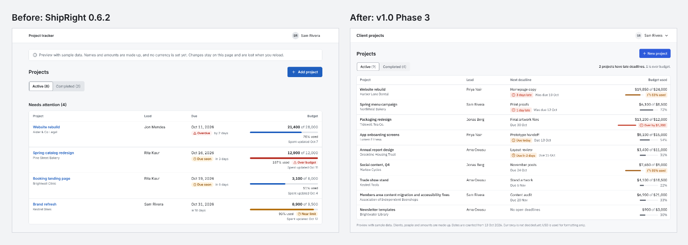
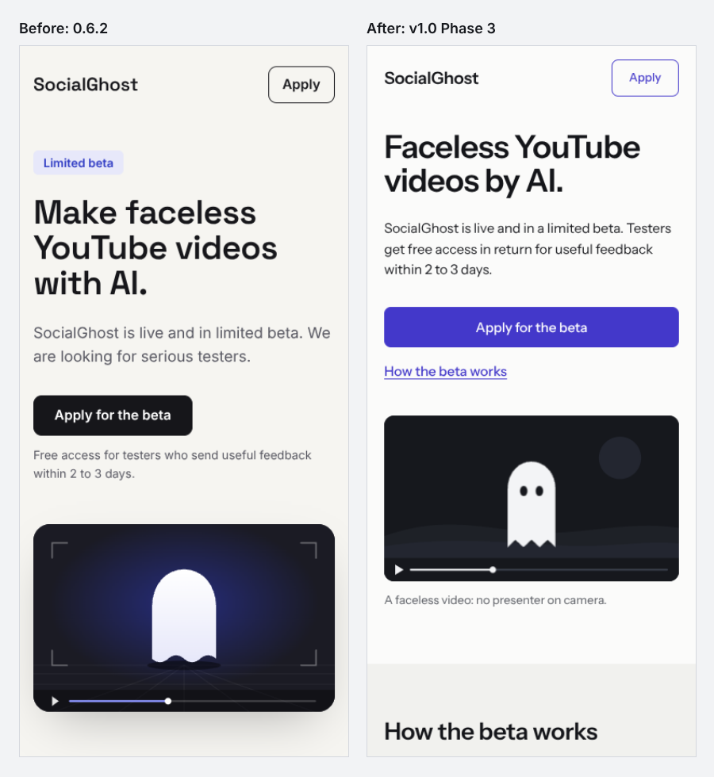

# ShipRight

**Version 1.0.0**
**Context before generate. Product before pixels.**

ShipRight is a skill pack for Claude Code, Cursor, Codex and other AI coding tools.
Bring an idea for a website, a SaaS app, a mobile app or a 3D site. You get a build pack: a PRD, a stack with reasons, a design system with tokens, screen specs, and small ordered tickets written as prompts you paste into your coding tool.
It does not guarantee a perfect product or replace testing with real users.

## Start

1. Keep the whole `shipright-skills/` folder together and readable by your tool.
2. Start with the entry file for your task.
3. Answer up to three quick questions, or say "you decide". Then you get the whole pack in one pass.

| Task | Entry file |
| --- | --- |
| Turn an idea into a build pack: PRD, stack, design system, screens and ticket prompts | [build-pack](skills/build-pack/SKILL.md) |
| Frame an idea or define a flow | [product-design](skills/product-design/SKILL.md) |
| Design a screen or apply exact visual feedback | [ui-ux-design](skills/ui-ux-design/SKILL.md) |
| Review an existing artifact | [ux-critique](skills/ux-critique/SKILL.md) |
| Check a launch or a specific release item | [ship-check](skills/ship-check/SKILL.md) |

Example:

> Read shipright-skills/skills/build-pack/SKILL.md. I want a booking app for my salon. Give me everything Cursor needs to build it.

Then paste ticket T1 into your coding tool. It sets up the project and a `/design` preview page. Check the look, then continue with T2.

## What you get

| File | What it holds |
| --- | --- |
| `docs/shipright/01-prd.md` | Who, the job, this release, what stays out, flows, success checks, open questions |
| `docs/shipright/02-technical-architecture.md` | Stack with reasons and switch points, data, routes, access, budgets |
| `DESIGN.md` and a token file | The design system. Your own system or Figma always wins; a new app starts from a starter system you approve |
| `docs/shipright/04-frontend-spec.md` | Each screen: layout order, components, states, phone behavior, accessibility, real copy |
| `docs/shipright/05-feature-ticket-list.md` | Paste-ready prompts, each with files to read, done-when checks and a stop line |
| `docs/shipright/build-rules.md` | Standing rules your coding tool reads before every change |

In trials a full pack ran 6,600 to 7,900 words (0.6.2: 8,000 to 10,400), and the chat reply about 300 words.

## What it is good at

- **Dense but calm screens.** Real information, clear hierarchy, nothing shouting. Four starter systems with measured contrast: calm dense product UI, mobile native, editorial marketing, immersive dark.
- **No AI slop.** No invented metrics, quotes, logos or prices. No gradient glow, eyebrow labels or rows of icon cards.
- **Motion and 3D with budgets.** GSAP, Lenis and React Three Fiber where they help, always with reduced-motion and a fallback image.
- **Checked, not hoped.** [scripts/check-ui.mjs](scripts/check-ui.mjs) opens a page in Chromium at 1280 and 390 wide and measures overflow, contrast, fonts, target size, labels, focus, motion handling and common slop tells.

```bash
node scripts/check-ui.mjs path/to/index.html --root path/to/site
```

It needs Node 18+ and Playwright with Chromium. It measures rules; it does not prove good design or full accessibility.

## How it improved

Same four requests, run by fresh agents with the old pack (0.6.2) and the new pack, then graded blind by separate agents who did not know which was which.

| Case | 0.6.2 | v1.0 (Phase 3) |
| --- | ---: | ---: |
| SaaS dashboard | 25 | 27 |
| Mobile form flow | 25 | 28 |
| Marketing site | 21 | 27 |
| 3D product site | 23 | 25 |
| **Total of 120** | **94** | **107** |

Biggest gains: paste-ready tickets, complete build packs, denser screens, less slop. Replies got about half as long; build packs about a quarter shorter.
Full results and limits: [Phase 3 trial](evals/v1/results-phase-3.md). The final v1.0 trial is in [results-final](evals/v1/results-final.md).

**SaaS dashboard.** More projects visible, each with its next deadline and budget, in one calm table.



**Marketing site.** No pill badge or glow; a full-width primary action on the phone with one text link.



**Mobile form flow** and **3D product site**: [mobile](examples/before-after/v1.0-phase-3/mobile-form/compare-phone.png), [3D](examples/before-after/v1.0-phase-3/3d-product/compare-desktop.png).

These are actual generated outputs from identical frozen prompts, not authored illustrations.
Earlier phases keep their own folders under `examples/before-after/`, for example [0.6.2](examples/before-after/0.6.2/ui-ux-design/compare.png).

## Tool setup

Claude Code, Cursor, Codex and ChatGPT can read the pack when it is in their workspace or attached.
For automatic discovery, register the canonical skill folders with your client's supported method. Avoid edited copies per client.
Native installs and Claude Design ingestion are not verified for this release. Manual file-based use is the portable route.
Do not copy this pack's AGENTS.md into your app. It is for maintaining ShipRight itself.

## Evidence and limits

Reviews separate specifications, visible designs and exercised implementation. Checks use Pass, Fail, Not verified or Not applicable.
Trials use one or two runs per case, graders from the same model family, and synthetic prompts. They are not user research or a cross-model benchmark.
Run the source checks from the pack root:

```bash
python3 -m pip install -r evals/requirements-context.txt
python3 evals/check_sources.py --self-test
python3 evals/check_context.py
python3 -m unittest discover -s tests -p 'test_*.py'
```

Historical evaluations stay unchanged under `evals/`. The [IVC example](examples/ivc-2026-registration/README.md) is historical and documents its own defects.

## Map

[skills.md](skills.md) routes tasks. [architecture.md](architecture.md) explains file ownership and loading. [SOURCES.md](SOURCES.md) credits every source. [CHANGELOG.md](CHANGELOG.md) and [release notes](RELEASE-NOTES.md) record changes.
[Altaz's profile](personal-taste/altaz.md) is opt-in and cannot change scope or override an approved identity.

MIT license for the pack. Example brand assets keep their existing ownership notices.
