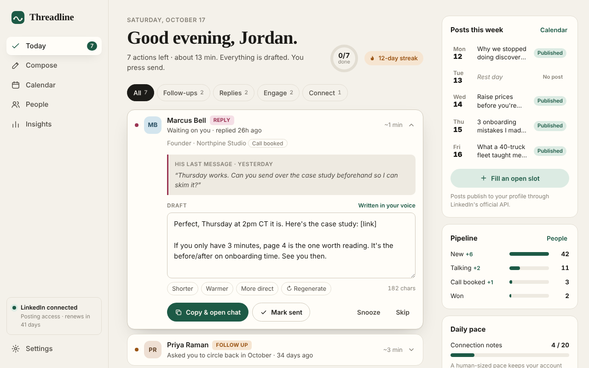
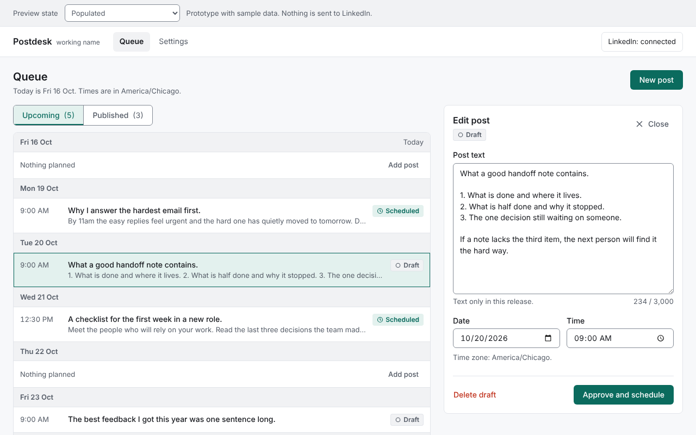
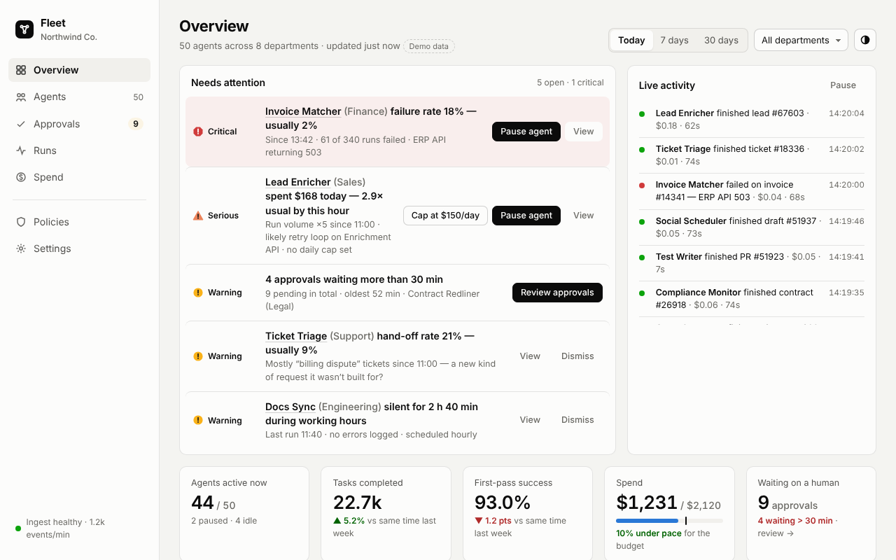

# ShipRight

**Version 1.3.1**
**Context before generate. Product before pixels.**

**1.3.1 is released.** Turn an idea into a tested product your AI builds right. Install from this repository (there is no zip). The Claude eval scores for 1.3 are still pending; see `evals/v2/runs/release-1.3/RUN-GUIDE.md`.

ShipRight is one skill, named `shipright`, for Claude Code, Cursor, Codex, VS Code, Antigravity, Gemini CLI, Claude.ai, and ChatGPT.
Bring an idea for a website, a SaaS app, a mobile app or a 3D site. You get a build pack: a PRD, a stack with reasons, a design system with tokens, screen specs, and small ordered tickets written as prompts you paste into your coding tool.
It does not guarantee a perfect product or replace testing with real users.

## Premium website flow

A public website now starts with a real product brief and six-act story. Its act list is the architecture. Three options change the story and technique set, then stop for your choice. The selected website prompt can use 550 to 1,700 words. App tickets stay short. New projects always run the full flow, even for "just build it".

Ten technique recipes load separately, only when selected. The premium checker allows purposeful labels and reveals while checking product visibility, declared proof sources and reduced-motion content. Taste critique asks whether the product is on stage, scroll teaches something and each act has a job. Missing real product on the first screen is a Blocker.

Two fresh builders used the updated pack, supplied facts and owner-selected stories. [ShipRight](examples/before-after/1.2/shipright/compare.png) and the [sample recorder](examples/before-after/1.2/field-recorder/compare.png) now have real screenshots and short scroll videos. A separate reviewer found issues, the builders fixed them, and [independent retests](examples/before-after/1.2/review/final-review.md) passed for local proof review. Initial findings and captures remain. No merge, tag or release has occurred. The standard install commands below still target the published main branch until this work is merged separately.

## 1.2 proof images and videos

| Proof | Before | After | Comparison | Scroll video |
| --- | --- | --- | --- | --- |
| ShipRight Product Manuscript | [Depth, PR 18](examples/before-after/1.2/depth/desktop.png) | [Desktop](examples/before-after/1.2/shipright/evidence/check-ui/desktop.png), [phone](examples/before-after/1.2/shipright/evidence/check-ui/phone.png) | [Before / after](examples/before-after/1.2/shipright/compare.png) | [WebM](examples/before-after/1.2/shipright/evidence/desktop-scroll.webm) |
| Field Recorder One, SAMPLE | [Depth reference](examples/before-after/1.2/depth/desktop.png) | [Desktop](examples/before-after/1.2/field-recorder/evidence/check-ui-polish/desktop.png), [phone](examples/before-after/1.2/field-recorder/evidence/check-ui-polish/phone.png) | [Different product proof](examples/before-after/1.2/field-recorder/compare.png) | [WebM](examples/before-after/1.2/field-recorder/evidence/scroll.webm) |

The comparisons use actual 1280x800 browser captures. Recorder is a separate synthetic product, not a former Depth product. The generated prompts are 1,019 and 1,076 words. Both builds pass; both premium checks have zero failures. Compact-label warnings remain disclosed. Reduced-motion and no-WebGL evidence is retained alongside the screenshots. Software WebGL and one fresh builder per proof do not establish physical-phone performance or universal model behavior. External reference screenshot fidelity is not verified because the earlier upload is absent and verified browser reference navigation still fails on environment trust; Brand Studio presents a CAPTCHA challenge.

## Website

The owner-approved Product Manuscript now has a standalone website in [site/](site/README.md), with real examples, IVC comparisons and installs for each supported format. See the [desktop](site/evidence/desktop.png), [phone](site/evidence/phone.png), [scroll video](site/evidence/scroll.webm), [critique](site/evidence/ux-critique.md) and [ship check](site/evidence/ship-check.md). Vercel configuration is included; the site has not been deployed.

## Install

One command installs the skill. Then type `/shipright`, or ask for a website, an app, a screen, a UX review, or a launch check. The tool can load the skill from its description. A marketplace install also lists `/shipright:shipright` for the same skill. There is no separate command file.
Build-pack is the default for a new idea. The other modes are product-design, ui-ux-design, ux-critique, and ship-check. They live inside this one skill.

| Tool | Command |
| --- | --- |
| Claude Code | `/plugin marketplace add aiwithaltaz/shipright-skills` then `/plugin install shipright@shipright` |
| Cursor | `npx skills add aiwithaltaz/shipright-skills -a cursor -y` |
| Codex | `npx skills add aiwithaltaz/shipright-skills -a codex -y` |
| VS Code | `npx skills add aiwithaltaz/shipright-skills -a github-copilot -y` |
| Antigravity | `npx skills add aiwithaltaz/shipright-skills -a antigravity -y` |
| Gemini CLI | `npx skills add aiwithaltaz/shipright-skills -a gemini-cli -y` |
| Claude.ai | Download [shipright.zip](dist/shipright.zip) and upload it under Customize, Skills |
| ChatGPT | Attach [shipright-chatgpt.md](dist/shipright-chatgpt.md) as project instructions or Custom GPT instructions |

`npx skills add aiwithaltaz/shipright-skills` also works. Add `-g` to install for every project. Rebuild the zip and the ChatGPT file with `python3 scripts/release_skill.py`.

Where the files land:

| Tool | Project path | Global path |
| --- | --- | --- |
| Claude Code | `.claude/skills/shipright/` | `~/.claude/skills/shipright/` |
| Cursor | `.agents/skills/shipright/` | `~/.cursor/skills/shipright/` |
| Codex | `.agents/skills/shipright/` | `~/.codex/skills/shipright/` |
| VS Code Copilot | `.agents/skills/shipright/` | `~/.copilot/skills/shipright/` |
| Antigravity | `.agents/skills/shipright/` | `~/.gemini/antigravity/skills/shipright/` |
| Gemini CLI | `.agents/skills/shipright/` | `~/.gemini/skills/shipright/` |

Codex also reads `~/.agents/skills/`. Copilot also reads `.github/skills/` and `.claude/skills/`. Cursor also reads `.cursor/skills/`. Antigravity also reads `~/.gemini/config/skills/`. For the Antigravity CLI, use `-a antigravity-cli`.

## Start

1. Install the skill, or keep this repository readable and start at [skills/shipright/SKILL.md](skills/shipright/SKILL.md).
2. Answer up to five decision cards, or delegate with "you decide". "Let me decide" reserves a choice. Apps usually need three cards. Public websites cover visitor, product hero, scroll story and assets. Clear briefs need no repeated questions.

| Task | Mode |
| --- | --- |
| Turn an idea into a build pack: PRD, stack, design system, screens and ticket prompts | [build-pack](skills/shipright/modes/build-pack/MODE.md) |
| Frame an idea or define a flow | [product-design](skills/shipright/modes/product-design/MODE.md) |
| Design a screen or apply exact visual feedback | [ui-ux-design](skills/shipright/modes/ui-ux-design/MODE.md) |
| Review an existing artifact | [ux-critique](skills/shipright/modes/ux-critique/MODE.md) |
| Check a launch or a specific release item | [ship-check](skills/shipright/modes/ship-check/MODE.md) |

Example:

> /shipright I want a booking app for my salon. Give me everything the coding tool needs to build it.

Then paste ticket T1 into your coding tool. It sets up the project and a `/design` preview page. Check the look, then continue with T2.

## What you get

| File | What it holds |
| --- | --- |
| `docs/shipright/01-prd.md` | Who, the job, this release, what stays out, flows, success checks, open questions |
| `docs/shipright/02-technical-architecture.md` | Stack with reasons and switch points, data, routes, access, budgets |
| `DESIGN.md` and a token file | The design system. Your own system or Figma always wins; a new app starts from a starter system you approve |
| `docs/shipright/04-frontend-spec.md` | Each screen: layout order, components, states, phone behavior, accessibility, real copy |
| `docs/shipright/05-feature-ticket-list.md` | Paste-ready prompts, each with files to read, done-when checks and a stop line |
| `docs/shipright/build-rules.md` | Standing rules your coding tool reads before every change |

In trials a full pack ran about 6,600 to 8,200 words (0.6.2: 8,000 to 10,400), and the chat reply about 300 words.

## What it is good at

- **Dense but calm screens.** Real information, clear hierarchy, nothing shouting. Four starter systems with measured contrast: calm dense product UI, mobile native, editorial marketing, immersive dark.
- **No AI slop.** No invented metrics, quotes, logos or prices. No gradient glow, eyebrow labels or rows of icon cards.
- **Motion and 3D with budgets.** GSAP, Lenis and React Three Fiber where they help, always with reduced-motion and a fallback image.
- **Checked, not hoped.** [scripts/check-ui.mjs](scripts/check-ui.mjs) opens a page in Chromium at 1280 and 390 wide and measures overflow, contrast, fonts, target size, labels, focus, motion handling and common slop tells.

```bash
node scripts/check-ui.mjs path/to/index.html --root path/to/site
```

It needs Node 18+ and Playwright with Chromium. It measures rules; it does not prove good design or full accessibility.

## How it works

A new idea runs stages 0 to 10. An existing app starts at discover. Nothing in that list is skipped because someone said to just build it.

| Stage | What it writes |
| --- | --- |
| 0 Discover | Screens, tasks, pains with evidence |
| 1 Research | Alternatives, each fact Verified or Assumed |
| 2 Brainstorm | Three concepts that differ in mechanism |
| 3 Problem solving | Every risk has a decision and a test |
| 4 Scope | The core loop and the page list |
| 5 Architecture | Stack, data, access, secrets, cost |
| 6 Design system | Tokens, one status table, one label table |
| 7 Options | Three layouts, one Proposed pick |
| 8 Build | The screen, sample data labeled |
| 9 Test | Checks at 390 and 1280, then a case study from the record |
| 10 Ship check | 20 items. A verdict is not permission to publish |

## 1.3 proof strip

These are real baseline 1.2 screenshots. They are not grades. 1.3 results coming.





### Score table

| Case | Opus plain | Sonnet + ShipRight 1.2 | Sonnet + ShipRight 1.3 |
| --- | --- | --- | --- |
| c1 to c3, c6 | runs exist, not graded | runs exist, not graded | results coming |
| c4 | run exists, not graded | not started | results coming |
| c5, c7, c8 | not started | not started | results coming |
| h1 groomer, h2 ceramic | not started | not started | results coming |

Limits: one run varies, a gap under 0.5 is a tie, and no 1.3 arm has been launched. Do not read a blank cell as a win. Haiku is report only and is also not started. Prompts: [evals/v2/runs/release-1.3/RUN-GUIDE.md](evals/v2/runs/release-1.3/RUN-GUIDE.md).

## How it improved

The 1.2 proofs replace the old ornament with the actual product: [Depth before](examples/before-after/1.2/depth/desktop.png), [ShipRight after](examples/before-after/1.2/shipright/evidence/check-ui/desktop.png), [before / after](examples/before-after/1.2/shipright/compare.png), and [sample product proof](examples/before-after/1.2/field-recorder/compare.png). See the proof table above for phone images and scroll videos.

Score tables, case notes, and earlier phase results are in [the history note](docs/HISTORY.md). Biggest 1.2 gains: paste-ready tickets, complete build packs, denser screens, less slop.

## Tool setup

Install from the table above. The skill folder is [skills/shipright/](skills/shipright/SKILL.md). Do not copy the five modes out as separate skills.
A tool with no skill support can use the ChatGPT file, or read `skills/shipright/SKILL.md` from this repository.
Do not copy this pack's AGENTS.md into your app. It is for maintaining ShipRight itself.

## Evidence and limits

Reviews separate specifications, visible designs and exercised implementation. Checks use Pass, Fail, Not verified or Not applicable.
Trials use one or two runs per case, graders from the same model family, and synthetic prompts. They are not user research or a cross-model benchmark.
Run the source checks from the pack root:

```bash
python3 -m pip install -r evals/requirements-context.txt
python3 evals/check_sources.py --self-test
python3 evals/check_context.py
python3 -m unittest discover -s tests -p 'test_*.py'
```

Historical evaluations stay unchanged under `evals/`. The [IVC example](examples/ivc-2026-registration/README.md) is historical and documents its own defects.

## Map

[skills.md](skills.md) routes tasks. [architecture.md](architecture.md) explains file ownership and loading. [SOURCES.md](SOURCES.md) credits every source. [CHANGELOG.md](CHANGELOG.md) and [release notes](RELEASE-NOTES.md) record changes.
[Altaz's profile](personal-taste/altaz.md) is opt-in and cannot change scope or override an approved identity.

## License

MIT license for the pack. Example brand assets keep their existing ownership notices.

**GSAP is not MIT.** It uses GSAP's own standard no-charge license (gsap.com/standard-license), which allows commercial use but has a prohibited-use clause. A copy is included only in `evals/v1/vendor/gsap/`, so the trial pages render offline. It is not part of the MIT pack. If your project uses GSAP, install it yourself under its own license.
three.js and Lenis in the same vendor folder are MIT and keep their own license files.
