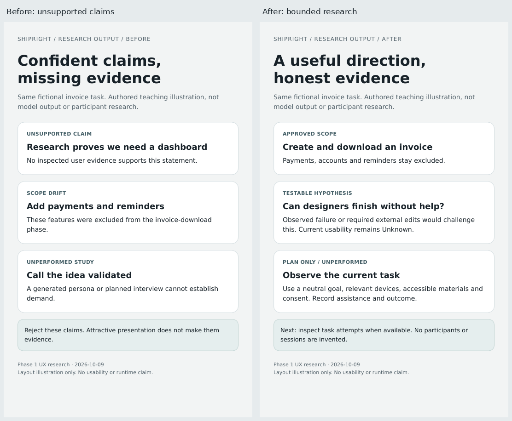
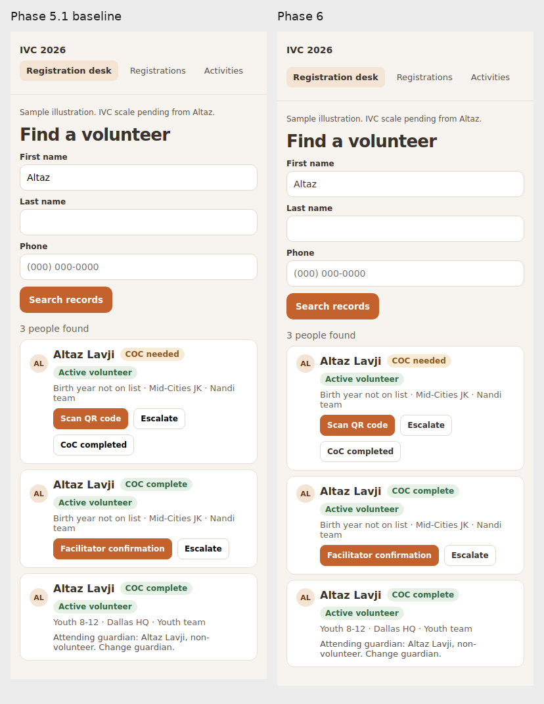

# ShipRight

**Version 0.6.2**
**Context before generate. Product before pixels.**

ShipRight helps AI design and coding tools follow your product decisions before generating UI.
It connects the user job, current phase, flows, screen layout and verification evidence.
It does not guarantee perfect designs or replace user testing.

## Start

1. Unzip this pack and keep the entire `shipright-skills/` folder together.
2. Make that folder readable by your tool. Start with the matching skill path below.
3. Supply your task, current phase and existing screen/docs when available. The skill asks only material missing questions.

| Task | Entry file |
| --- | --- |
| Frame an idea or define a flow | [product-design](skills/product-design/SKILL.md) |
| Design a screen or apply exact visual feedback | [ui-ux-design](skills/ui-ux-design/SKILL.md) |
| Review an existing artifact | [ux-critique](skills/ux-critique/SKILL.md) |
| Check a launch or specific release item | [ship-check](skills/ship-check/SKILL.md) |

Example for a local coding tool:

> Read shipright-skills/skills/ui-ux-design/SKILL.md and its required references. Our current phase is registration. Apply this feedback exactly: [changes]. Preserve the existing design system. Keep later ideas out of the UI.

Use the actual unpacked path if different. Keep `_shared`, references, docs and personal-taste available at their original relative locations.
A single pasted SKILL.md is incomplete; its fallback rules do not reproduce the full pack.
Do not copy this pack's AGENTS.md into your app. It is for maintaining ShipRight itself.

## Tool setup

Claude Code, Cursor, Codex, and ChatGPT can read the local Markdown pack when it is available in their workspace or attached files.
For automatic skill discovery, use the current client's supported registration method and point it to the canonical skill files.
Avoid separate edited copies for each client. Symlink handling and sandbox access vary; confirm references resolve in your client.
For a design tool without local file access, provide the whole pack through its supported file/project context mechanism.
Claude Design ingestion and all native client installs have not been verified for this release. Manual file-based use is the portable route.

## What changes in 0.6

- Exact feedback becomes keep/remove/change/add instructions with acceptance checks.
- Current-phase scope controls every visible element. Later ideas stay in notes, not UI.
- Intake asks 0-5 questions total before starting; clear tasks need none.
- Existing identity and components are preserved. Brand values, data and features are never invented.
- Flow feedback uses the operator's language and hides routine system plumbing.
- Layout, selection, pending work and accessibility have concrete checks.
- Shorter skill entries load detailed references only when relevant.
- 0.6.1-draft restores concrete icon, placement and question-card rules, and moves the IVC corrections into the example.

## Phase 2 synthesis update (no new release)

Product-design can optionally turn supplied records into traceable findings and proposed decisions. It preserves contradictory evidence and isolated serious problems, separates recalled accounts from observed actions, and keeps weak conclusions as hypotheses. Users see concise findings, limits and recommendations; evidence does not authorize new scope or validate a solution. Clear corrections and planning-only tasks skip synthesis. No automatic personas, screens or visual artifacts.

## Phase 3 IA update (no new release)

Product-design can optionally organize approved objects/content, relationships, labels, navigation, search/filter scope and structural maps before screens. Actual roles and capabilities control access; hidden navigation is never security enforcement. Card sorting and tree testing are optional plans unless real evidence exists. Clear corrections and sufficiently defined structures skip IA. No new features, invented routes or visual artifacts follow from a map. Results and limits are in [Phase 3 results](evals/phase-3-information-architecture/results.md).

## Phase 4 mapping update (no new release)

Product-design can optionally choose one evidence-grounded journey, task flow, known system process or service blueprint. Navigation remains with IA. Current evidence stays separate from proposed changes; missing emotions, teams, channels and business processes remain Unknown. Isolated accessibility/safety and interruption/return/recovery issues stay visible. Guidance loads only when relevant; no automatic maps, screens or visual artifacts. Results and limits are in [Phase 4 results](evals/phase-4-journeys-blueprints/results.md).

## Phase 5 design-system update (no new release)

Ui-ux-design now conditionally inspects/reuses the existing system, coordinates ten foundations and applies proportionate naming/documentation/contribution guidance. Existing identity and approved icon exceptions remain; no default rebrand, new token architecture, component contracts or mandatory governance. Component Gallery is a comparison/reference index, not an installable system or usability proof.

The frozen comparison scored 138/144 baseline and 142/144 updated, with no scored regressions or critical errors; four cases tied. Two updated governance replies still omitted unavailable source-version information. [Full results and limitations](evals/phase-5-design-systems/results.md) retain every response/grade and historical evidence.

These are [actual generated Projects screens](examples/before-after/phase-5-design-systems/ui-ux-design/compare.png) and [detail screens](examples/before-after/phase-5-design-systems/ui-ux-design/compare-detail.png), from identical frozen tasks, not authored bad/good illustrations. Both generated previews passed the exercised desktop/phone navigation, keyboard focus and overflow checks. This does not prove superior visual design or real usability.

## Phase 5.1 design system first (no new release)

Before screens or a coding handoff, record a small system. An existing app is extracted and marked Observed. A new app stays Proposed until you agree. Numbers in a handoff come from that system. Vocabulary, control choice and reference systems load only for that job. Component Gallery by Iain Bean is credited. Definitions are not copied.

The [IVC 2026 frames](examples/ivc-2026-registration/figma-redesign/README.md) show grouped form sections, status pills next to the name, and one named next step. The scale is pending from Altaz. The frozen Phase 5 scores are unchanged and do not cover this amendment.

## Context budgets

The knowledge collection can grow without a global word cap. Small entry files load task-relevant references directly. Maximums: 4,500 tokens per entry, 2,000 per shared file, 4,000 per reference, and 12,000 per declared normal loading path. Contract and intake stay small and always loaded; safeguards must not be skipped to fit a budget.

See [architecture](architecture.md#bounded-context-growing-knowledge) for shared totals, ownership and counting limits, and [tests](tests/README.md#context-budget-maintenance) for required checks. Token counts use a pinned reference tokenizer; client behavior and provider counts vary. This is architecture maintenance, with no new visual artifacts or Phase 2 content.

## Requested outputs

### Phase 1 research update (no new release)

Product-design can select research methods, prepare lightweight guides and distinguish
reported claims, observed behavior, interpretations, hypotheses and unknowns.
It inspects supplied evidence first; clear corrections do not trigger discovery.
Unavailable tools or participants remain explicit. Simulated users never count as research.
Users see concise decisions, material assumptions and limits; detailed plans are supplied only when useful/requested.
This update does not add full research synthesis or establish demand through a competitor scan.

A small fix gets a small response. A full project can use PRODUCT.md, DESIGN.md and the templates under docs/.
Other project documents normally live under docs/shipright/. Reuse existing equivalents.
A request to write authorizes the requested files. Read before updating and preserve unrelated content.
The pitch and full launch report are optional. Readiness never authorizes deployment, publication or payment.

## Evidence

Reviews distinguish specifications, visible designs and exercised implementation.
Checks use Pass, Fail, Not verified or Not applicable with a reason. A ticket does not resolve a failure.

Run source validation from the unpacked folder:

```bash
python3 evals/check_sources.py
python3 evals/check_sources.py --self-test
```

See [0.6 evaluation evidence](evals/v0.6/results.md). Source checks and controlled trials do not establish cross-model or client performance.
See [Phase 1 research evaluation](evals/phase-1-ux-research/results.md) for the preserved original comparison.
See [stronger evaluations and final checks](evals/phase-1-ux-research/stronger/results.md) for the separate follow-up evidence and limits.
The [IVC example](examples/ivc-2026-registration/README.md) is historical and includes documented defects and evidence limits.
Do not use its prototype or training candidates as current approved implementation guidance.

## Optional preferences and map

[Altaz's profile](personal-taste/altaz.md) is active only when selected. It cannot change scope or override approved identity.
[skills.md](skills.md) routes tasks. [architecture.md](architecture.md) explains file ownership and loading.
[CHANGELOG.md](CHANGELOG.md) records the release. Names and original paths are retained.

## How it improved

Each pair is the same idea, shown on a phone-width screen. Before is the polished generic screen 0.6.1-draft allowed. After is what this version asks for. Numbers, quotes, and prices on the before screens were not supplied.

**Product design.** A salon booking idea. The old path drew a marketing site. The new path keeps one booking task.

[Before](examples/before-after/0.6.2/product-design/before.png) and [after](examples/before-after/0.6.2/product-design/after.png).


**UI/UX design.** The same booking task. The old layout has a gradient, summary cards, unlabeled fields, and two filled buttons. The new layout has labels, one action, and a way back.

[Before](examples/before-after/0.6.2/ui-ux-design/before.png) and [after](examples/before-after/0.6.2/ui-ux-design/after.png).


**UX critique.** The same order desk. The old write-up restyles it. The new write-up names the fix.

[Before](examples/before-after/0.6.2/ux-critique/before.png) and [after](examples/before-after/0.6.2/ux-critique/after.png).


**Ship check.** No site was supplied. The old path filled a launch list. The new path asks one question and stops.

[Before](examples/before-after/0.6.2/ship-check/before.png) and [after](examples/before-after/0.6.2/ship-check/after.png).


Future updates keep a new folder under `examples/before-after/` and follow [tests/README.md](tests/README.md).

**Phase 1 research output.** A task-aligned research plan versus an ungrounded research claim.
Both are authored teaching illustrations, not participant evidence or controlled model output.



**Phase 1 guide fixes.** Recalled behavior is distinguished from directly observed work; prompting instructions and outcome tables share four categories. These are authored print-rendered illustrations, not model outputs or usability evidence.

[Before](examples/before-after/phase-1-guide-fixes/product-design/before.png) and [after](examples/before-after/phase-1-guide-fixes/product-design/after.png).


**Phase 5.1, person details.** An authored phone-width illustration of the required system step. Before is a generic screen: a gradient, filler ratings and a quote, a card around every section, and two filled buttons. After groups fields, puts a status pill next to the name, and keeps one next action. It is not model output and not Altaz's measured scale.

[Before](examples/before-after/phase-5-1-amendment/ui-ux-design/before.png) and [after](examples/before-after/phase-5-1-amendment/ui-ux-design/after.png).


## Phase 6 design-token update (no new release)

Tokens now record the required Phase 5.1 system on separate conditional paths: small primitives/semantic roles, component tokens only with a reuse reason, optional approved modes and actual consumer mappings. Existing systems remain Observed and reused; new systems need the user's OK before screens. No forced tooling, replacement system or Phase 7 contracts. [Source credits](skills/ui-ux-design/references/token-sources.md) are original summaries of DTCG, Atlassian, Style Dictionary and Tokens Studio guidance.

All 199 tests and 177 mutation checks passed. The frozen comparison tied at 48/48; no behavioral improvement or scored regression was demonstrated. Replies became longer at the median (318.5 to 455 words). Preserve [full results and limitations](evals/phase-6-design-tokens/results.md).

These are actual independently generated styled samples of the same screen, not an authored poor baseline. [Desktop](examples/before-after/phase-6-design-tokens/compare.png) and [phone](examples/before-after/phase-6-design-tokens/compare-phone.png) screenshots preserve the sample-only styling. The [IVC worked example](examples/ivc-2026-registration/token-worked-example.md) keeps the real scale pending from Altaz. Both samples retain a disclosed source-color contrast failure, and neither proves real token propagation, full accessibility or better visual design.



MIT license for the pack. Example brand assets retain their existing ownership notices.
