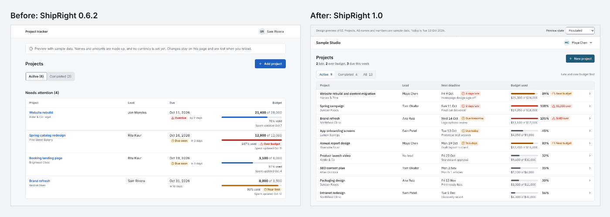
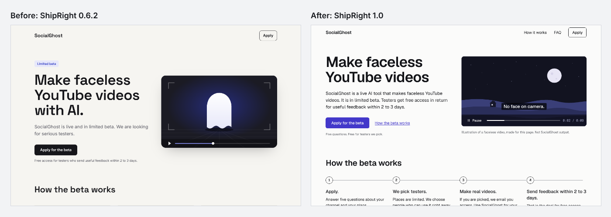
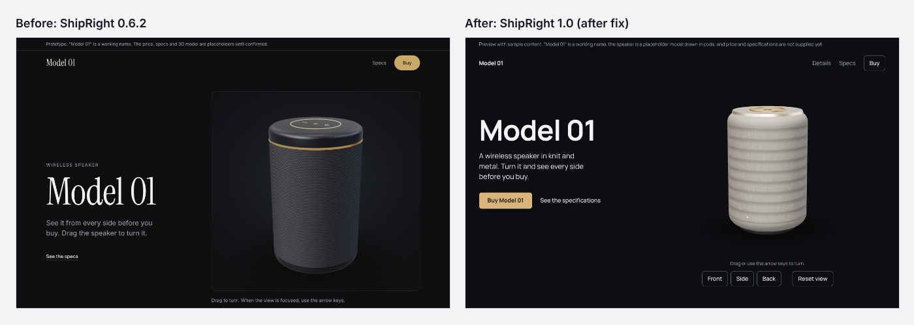

# ShipRight

**Version 1.1.0**
**Context before generate. Product before pixels.**

ShipRight is one skill, named `shipright`, for Claude Code, Cursor, Codex, VS Code, Antigravity, Gemini CLI, Claude.ai, and ChatGPT.
Bring an idea for a website, a SaaS app, a mobile app or a 3D site. You get a build pack: a PRD, a stack with reasons, a design system with tokens, screen specs, and small ordered tickets written as prompts you paste into your coding tool.
It does not guarantee a perfect product or replace testing with real users.

## Install

One command installs the skill. Then type `/shipright`, or ask for a website, an app, a screen, a UX review, or a launch check. The tool can load the skill from its description. A marketplace install also lists `/shipright:shipright` for the same skill. There is no separate command file.
Build-pack is the default for a new idea. The other modes are product-design, ui-ux-design, ux-critique, and ship-check. They live inside this one skill.

| Tool | Command |
| --- | --- |
| Claude Code | `/plugin marketplace add aiwithaltaz/shipright-skills` then `/plugin install shipright@shipright` |
| Cursor | `npx skills add aiwithaltaz/shipright-skills -a cursor -y` |
| Codex | `npx skills add aiwithaltaz/shipright-skills -a codex -y` |
| VS Code | `npx skills add aiwithaltaz/shipright-skills -a github-copilot -y` |
| Antigravity | `npx skills add aiwithaltaz/shipright-skills -a antigravity -y` |
| Gemini CLI | `npx skills add aiwithaltaz/shipright-skills -a gemini-cli -y` |
| Claude.ai | Download [shipright.zip](dist/shipright.zip) and upload it under Customize, Skills |
| ChatGPT | Attach [shipright-chatgpt.md](dist/shipright-chatgpt.md) as project instructions or Custom GPT instructions |

`npx skills add aiwithaltaz/shipright-skills` also works. Add `-g` to install for every project. Rebuild the zip and the ChatGPT file with `python3 scripts/release_skill.py`.

Where the files land:

| Tool | Project path | Global path |
| --- | --- | --- |
| Claude Code | `.claude/skills/shipright/` | `~/.claude/skills/shipright/` |
| Cursor | `.agents/skills/shipright/` | `~/.cursor/skills/shipright/` |
| Codex | `.agents/skills/shipright/` | `~/.codex/skills/shipright/` |
| VS Code Copilot | `.agents/skills/shipright/` | `~/.copilot/skills/shipright/` |
| Antigravity | `.agents/skills/shipright/` | `~/.gemini/antigravity/skills/shipright/` |
| Gemini CLI | `.agents/skills/shipright/` | `~/.gemini/skills/shipright/` |

Codex also reads `~/.agents/skills/`. Copilot also reads `.github/skills/` and `.claude/skills/`. Cursor also reads `.cursor/skills/`. Antigravity also reads `~/.gemini/config/skills/`. For the Antigravity CLI, use `-a antigravity-cli`.

## Start

1. Install the skill, or keep this repository readable and start at [skills/shipright/SKILL.md](skills/shipright/SKILL.md).
2. Answer up to three quick questions, or say "you decide". Then you get the whole pack in one pass.

| Task | Mode |
| --- | --- |
| Turn an idea into a build pack: PRD, stack, design system, screens and ticket prompts | [build-pack](skills/shipright/modes/build-pack/MODE.md) |
| Frame an idea or define a flow | [product-design](skills/shipright/modes/product-design/MODE.md) |
| Design a screen or apply exact visual feedback | [ui-ux-design](skills/shipright/modes/ui-ux-design/MODE.md) |
| Review an existing artifact | [ux-critique](skills/shipright/modes/ux-critique/MODE.md) |
| Check a launch or a specific release item | [ship-check](skills/shipright/modes/ship-check/MODE.md) |

Example:

> /shipright I want a booking app for my salon. Give me everything the coding tool needs to build it.

Then paste ticket T1 into your coding tool. It sets up the project and a `/design` preview page. Check the look, then continue with T2.

## What you get

| File | What it holds |
| --- | --- |
| `docs/shipright/01-prd.md` | Who, the job, this release, what stays out, flows, success checks, open questions |
| `docs/shipright/02-technical-architecture.md` | Stack with reasons and switch points, data, routes, access, budgets |
| `DESIGN.md` and a token file | The design system. Your own system or Figma always wins; a new app starts from a starter system you approve |
| `docs/shipright/04-frontend-spec.md` | Each screen: layout order, components, states, phone behavior, accessibility, real copy |
| `docs/shipright/05-feature-ticket-list.md` | Paste-ready prompts, each with files to read, done-when checks and a stop line |
| `docs/shipright/build-rules.md` | Standing rules your coding tool reads before every change |

In trials a full pack ran about 6,600 to 8,200 words (0.6.2: 8,000 to 10,400), and the chat reply about 300 words.

## What it is good at

- **Dense but calm screens.** Real information, clear hierarchy, nothing shouting. Four starter systems with measured contrast: calm dense product UI, mobile native, editorial marketing, immersive dark.
- **No AI slop.** No invented metrics, quotes, logos or prices. No gradient glow, eyebrow labels or rows of icon cards.
- **Motion and 3D with budgets.** GSAP, Lenis and React Three Fiber where they help, always with reduced-motion and a fallback image.
- **Checked, not hoped.** [scripts/check-ui.mjs](scripts/check-ui.mjs) opens a page in Chromium at 1280 and 390 wide and measures overflow, contrast, fonts, target size, labels, focus, motion handling and common slop tells.

```bash
node scripts/check-ui.mjs path/to/index.html --root path/to/site
```

It needs Node 18+ and Playwright with Chromium. It measures rules; it does not prove good design or full accessibility.

## How it improved

Same four requests, run by fresh agents with the old pack (0.6.2) and the new pack, then graded blind by separate agents who did not know which was which.

| Case | 0.6.2 | v1.0 |
| --- | ---: | ---: |
| SaaS dashboard | 24 | 29 |
| Mobile form flow | 24 | 29 |
| Marketing site | 22 | 28 |
| 3D product site | 23 | 26 (after fix; first run 19, see below) |
| **Total of 120** | **93** | **112** |

The first final 3D run hid its content behind a scroll animation and was marked unshippable. The motion rule and the checker were fixed, and a fresh blind re-check scored 26. An earlier trial after Phase 3 scored 107 against 94.

Biggest gains: paste-ready tickets, complete build packs, denser screens, less slop. Replies got about half as long; build packs about a quarter shorter.
Full results and limits: [final trial](evals/v1/results-final.md) and [Phase 3 trial](evals/v1/results-phase-3.md).

**SaaS dashboard.** More projects visible, each with its next deadline and budget, in one calm table.



**Marketing site.** No pill badge or glow; the real beta terms and steps on the first screen.



**3D product site.** This image is the re-run after the motion fix, not the first final run (which scored 19 and hid its content). Buy is in the hero, view buttons sit under the model, and it uses a working name instead of placeholders.



**Mobile form flow:** [phone comparison](examples/before-after/v1.0/mobile-form/compare-phone.png). Phase 3 images are in `examples/before-after/v1.0-phase-3/`.

These are actual generated outputs from identical frozen prompts, not authored illustrations.
Earlier phases keep their own folders under `examples/before-after/`, for example [0.6.2](examples/before-after/0.6.2/ui-ux-design/compare.png).

## Tool setup

Install from the table above. The skill folder is [skills/shipright/](skills/shipright/SKILL.md). Do not copy the five modes out as separate skills.
A tool with no skill support can use the ChatGPT file, or read `skills/shipright/SKILL.md` from this repository.
Do not copy this pack's AGENTS.md into your app. It is for maintaining ShipRight itself.

## Evidence and limits

Reviews separate specifications, visible designs and exercised implementation. Checks use Pass, Fail, Not verified or Not applicable.
Trials use one or two runs per case, graders from the same model family, and synthetic prompts. They are not user research or a cross-model benchmark.
Run the source checks from the pack root:

```bash
python3 -m pip install -r evals/requirements-context.txt
python3 evals/check_sources.py --self-test
python3 evals/check_context.py
python3 -m unittest discover -s tests -p 'test_*.py'
```

Historical evaluations stay unchanged under `evals/`. The [IVC example](examples/ivc-2026-registration/README.md) is historical and documents its own defects.

## Map

[skills.md](skills.md) routes tasks. [architecture.md](architecture.md) explains file ownership and loading. [SOURCES.md](SOURCES.md) credits every source. [CHANGELOG.md](CHANGELOG.md) and [release notes](RELEASE-NOTES.md) record changes.
[Altaz's profile](personal-taste/altaz.md) is opt-in and cannot change scope or override an approved identity.

## Website

The public site lives in [site/](site/README.md). It is a static Astro app. Deploy it on Vercel with the root directory set to `site`. This repository does not deploy or publish it on its own.

## License

MIT license for the pack. Example brand assets keep their existing ownership notices.

**GSAP is not MIT.** It uses GSAP's own standard no-charge license (gsap.com/standard-license), which allows commercial use but has a prohibited-use clause. A copy is included only in `evals/v1/vendor/gsap/`, so the trial pages render offline. It is not part of the MIT pack. If your project uses GSAP, install it yourself under its own license.
three.js and Lenis in the same vendor folder are MIT and keep their own license files.
