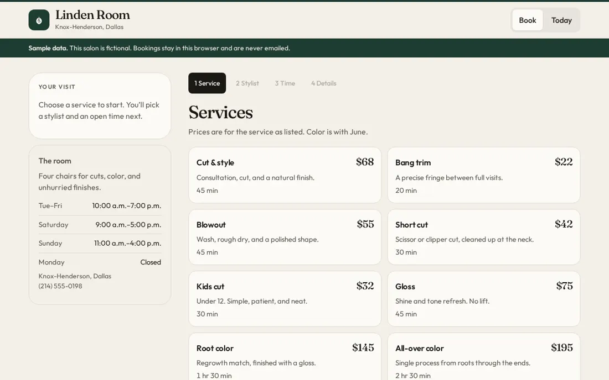
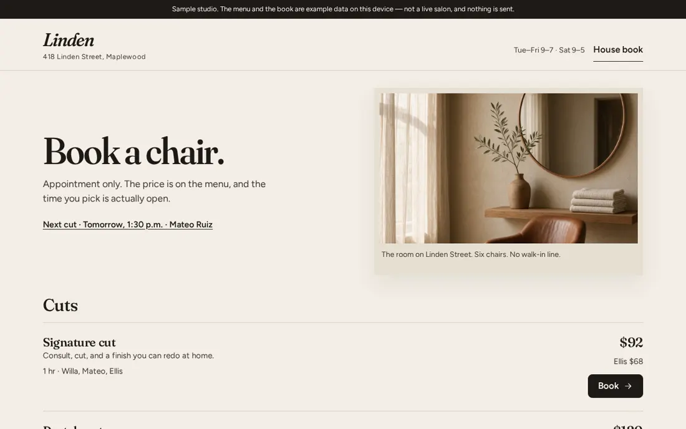
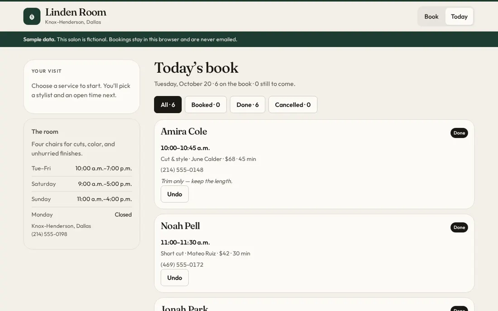

# Case study

Status: current

The salon A/B test. Same prompt, same model (Grok 4.7 in Grok Build), once without ShipRight and once with the reference-first ShipRight pack. Sample studio, no real client.

## Problem

AI builds of a small salon booking app look like admin tools, and the client and owner sides get mixed.

## Who

Salon clients who want to book fast, and the owner who runs the day. Supplied by the test prompt.

## Research

Verified by using both live builds on 20 October 2026: https://shipright-test-salon-a.vercel.app (without) and https://shipright-test-salon-b.vercel.app (with).

- Without: the client lands in a form with a side panel. Verified.
- Without: the owner view still shows the client booking panel. Verified.
- With: a studio style client page and a separate owner Today view. Verified.

No quotes were invented. Assumed: nothing in this file.

## Idea

Compare one prompt, built twice, and show why the ShipRight build made each choice.

## Decisions

- D1. Two users, two sides. Proposed. Tradeoff: two shells to keep in sync.
- D2. References of the same product type (boutique studio sites). Proposed. Tradeoff: less reuse of dashboard patterns.
- D3. Brand mood first: warm quiet studio, #f3eee6, #8f4334, #234237. Proposed.
- D4. Fraunces headlines, Figtree body. Proposed.
- D5. Booking in four steps with prices up front. Proposed.
- D6. Basics: one spacing scale, focus outlines, skip link, sample note. Proposed.

## Pains

## System

The salon build uses paper cream, copper and moss with Fraunces and Figtree. The ShipRight site keeps its own paper, ink and sealing wax red.

## Process

Grok Build ran the same prompt twice. The second run had the reference-first pack attached.

## Results

Graded by ShipRight Lab with RUBRIC.md, not blind. Craft out of 40: without 28, with 31. Product thinking out of 28: without 21, with 24.

## Next

Fix the weak spots in the ShipRight build (phone first screen shows no service, no next-up focus for the owner, stale stylist price note), then run a blind grading.
