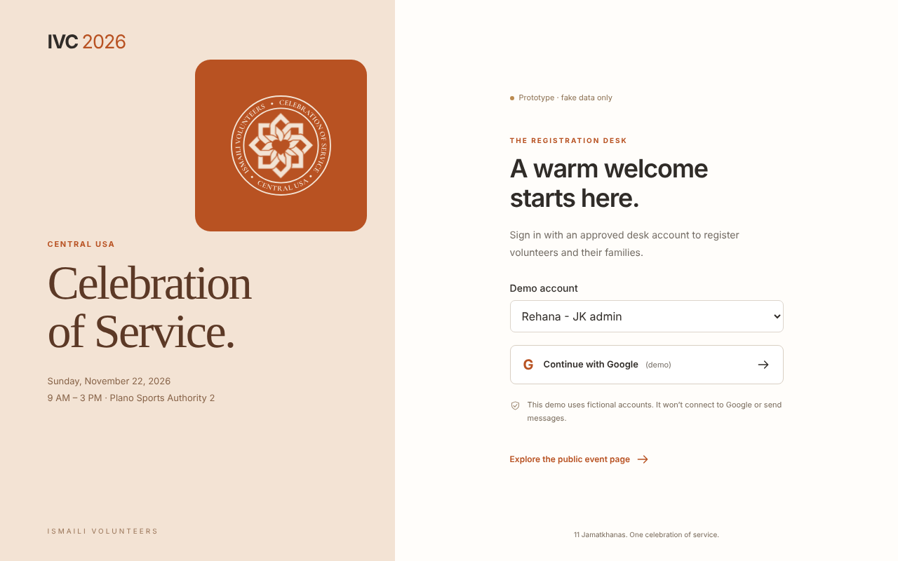
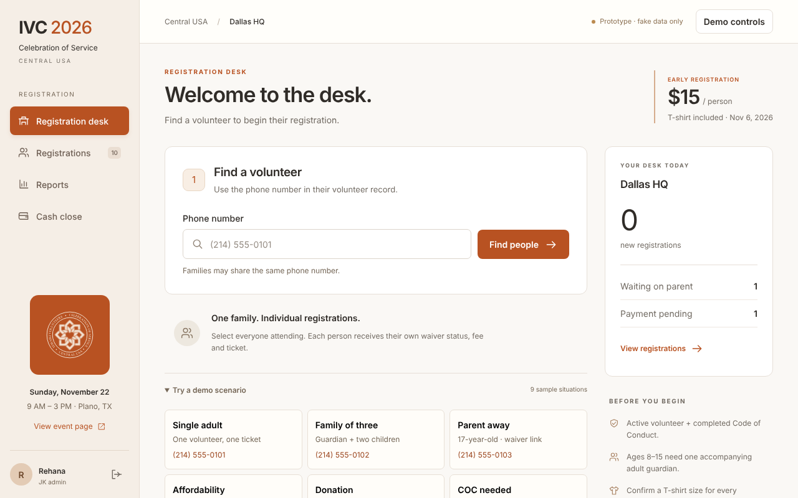
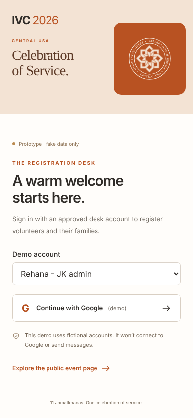

# Case study

Status: current

Built from the c7 baseline only. No rebuild run. No client name.

## Problem

The desk screen makes registration harder than the job.

## Who

Desk volunteers, registering people and their families on event day. Supplied by the case message.

## Research

Verified from the owner review of 25 September 2026 and 4 October 2026. The review lists 20 pains and 3 keeps.

- F01. Branding is too big for a work screen. Verified.
- F02. Reference facts repeat and always take space. Verified.
- F03. The before-you-begin panel adds little. Verified.
- F05. Lookup is by phone only. Verified.
- Keeps, also Verified: F04 regional context, F23 the registrations list, F26 reports.

No quotes were invented. Assumed: nothing in this file.

## Idea

No concept round was run for this draft. There is no chosen idea, and there are no two rejected ideas, in the baseline evidence.

## Decisions

- D1. Publish the baseline, not a made-up after screen. Proposed. Tradeoff: the page cannot show a redesign yet.
- D2. Do not print a score. Proposed. Tradeoff: the proof section stays empty until graders run.

## Pains

Before shots only. There is no after shot from a rebuild.

## System

No design-system image was made for this baseline. The desk prototype keeps its own styles.

## Process

Stages were not run on this prototype for this draft. This page is the evidence sample, not a build.

## Results

Not measured. No test of a rebuild. No step count. No load time. No score.

## Next

Run c7 again with this draft. Then recall the 20 pains and the 3 keeps. Then ask the owner before naming anyone. See the handoff in this record.
